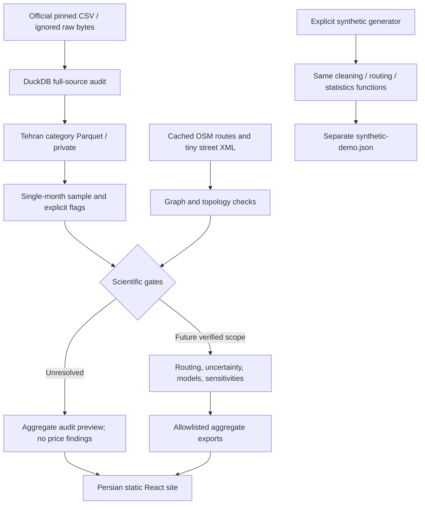

# Architecture

The app is a static publication over explicit research artifacts. Python and the browser never exchange listing records. There is no database server or API to operate.

`audit.py` does the expensive source parsing once into a run-local DuckDB database; repeated distributions operate against that table. Parquet strips descriptions, titles and seller fields from downstream selected rows. `cleaning.py` defines filters, source-value preservation and flags. `geographic.py` builds unsimplified metric graph segments from actual OSM node sequences. `accessibility.py` uses a cKDTree and reverse super-source Dijkstra; it avoids a routing call for every possible destination. `statistics.py` implements staged models with shared complete-case samples and a small suite of scenario checks. `aggregation.py` is the public boundary; its allowlists and recursion guard prevent accidental listing-level exports.

`cli.py` creates immutable run directories and explicit derived public aliases. In v0.1 empirical stage commands share post-audit preparation; they do not pretend that network/model stages passed. The full numerical vertical slice executes with generated fixtures. A future verified-input pipeline needs reviewed price semantics, a large buffered graph, station eligibility and additional empirical sensitivity diagnostics.

The site imports the shared TypeScript public contract, validates it at runtime, and refuses synthetic/default or unexpected price-bearing input. It is intentionally a preview-only renderer. Future findings require an explicit schema and UI review. The map is a separate chunk, uses only the safe OSM street export, and makes no tile requests by default. Persian fonts are bundled locally. Optional external basemap URLs must have a reviewed provider license and safe public configuration.

Run evidence stays under `artifacts/runs/`; only safe audit/validation summaries and public outputs are tracked. Public duplicate copies are generated by `scripts/sync-public.mjs` during setup/build. Source inputs and run intermediates are never copied into `apps/web/public`.
