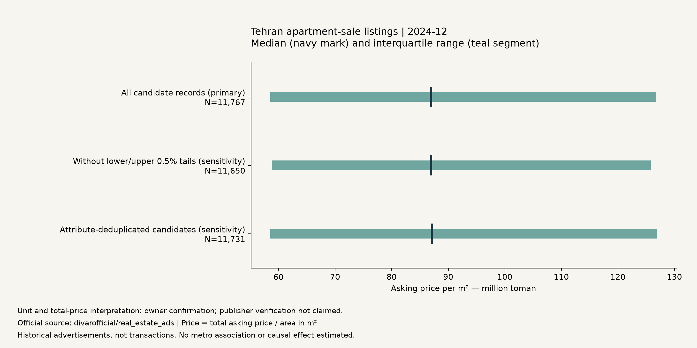
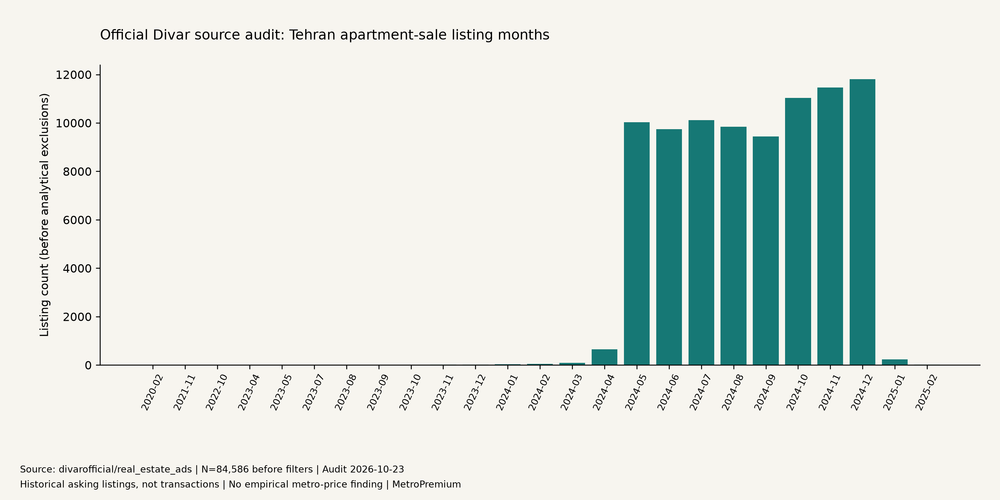

# Findings: initial evidence, 22 October 2026

Current exploratory update, 23 October 2026: the historical mapped-entrance extension has executed on real data. It supports 2,978 routes and 2,962 common complete model cases. The neighborhood-adjusted interval spans zero and location perturbations change the estimate's sign. See the separate [mapped-reference findings](mapped-reference-findings.md); primary operational metro-access approval remains closed. The housing-only findings and preserved initial audit below retain their original scope.

## Current update — 23 October 2026

After inspecting actual source records, the owner confirmed that `price_value` is the **total apartment asking price in toman**. This is recorded as owner-provided evidence in [price-interpretation.md](price-interpretation.md); publisher verification is not claimed. The original audit below is preserved as the earlier evidence state. The change enables division by area without currency rescaling and does not alter the raw data or candidate population.

For the same **11,767 December 2024 records**, the computed median asking price per m² is **86,986,301.37 toman**, with an interquartile range of **58,541,019.96–126,666,666.67 toman/m²**. Median total asking price is **7,000,000,000 toman** and median area is **85 m²**; the median price/area ratio is not computed by dividing those separate medians. These are observed advertisement distributions, not transaction prices, confidence intervals or a description of today's market.

| Prespecified description / sensitivity | n | Median asking price (million toman/m²) | IQR (million toman/m²) |
|---|---:|---:|---|
| All candidate records — primary, no price-tail exclusion | 11,767 | 86.9863 | 58.5410–126.6667 |
| Exclude values outside the 0.5/99.5 percentile bounds | 11,650 | 86.9863 | 58.8235–125.8266 |
| Remove later attribute-duplicate candidates | 11,731 | 87.1429 | 58.5599–126.8811 |

There are **117 price-tail flags** and **36 later duplicate candidates** in the primary month. Quantile ties mean tail flags are not necessarily exactly 1% of observations. Flagged rows remain in the primary summary. Removing them here is a sensitivity scenario, not a declaration that all flagged rows are erroneous or all retained rows are valid. Attribute matches are not verified repeat properties. Similar overall medians do not prove geographic or model robustness.

The denominator includes records without coordinates; geographic eligibility is not needed for housing-only descriptions. Neighborhood-month price summaries require at least 30 measured values, report median/IQR, and remain ineligible for an affordability/access ranking. No metro distance, price/access coefficient or causal conclusion is estimated. See [computed JSON](../artifacts/reports/housing-descriptives.json), [CSV](../artifacts/reports/housing-descriptives.csv), and the actual figure:

## Preserved initial snapshot — before owner price confirmation

These results come from the full official source audit and deterministic cleaning. They do not answer the metro-price association questions yet. Machine-readable evidence: [audit](../artifacts/audits/source-audit.json), [sample flow](../artifacts/reports/sample-flow.json), [network checks](../artifacts/reports/network-validation.json).

## Dataset audit

The pinned CSV contains exactly **1,000,000 rows and 60 columns**. The source card reports 57 columns and six months of 2024. Actual month distributions are included in the audit, including dates outside 2024; no attempt was made to silently reconcile this conflict.

The category predicate selects **84,586** Tehran apartment-sale advertisements. Their observed month range is February 2020–February 2025 (not the full-source range). Counts in the main 2024 months are:

| Month (Gregorian) | Selected ads before cleaning |
|---|---:|
| 2024-05 | 10,024 |
| 2024-06 | 9,743 |
| 2024-07 | 10,117 |
| 2024-08 | 9,846 |
| 2024-09 | 9,447 |
| 2024-10 | 11,028 |
| 2024-11 | 11,467 |
| 2024-12 | 11,802 |

The selected population has 63,126 coordinate pairs, all within world ranges; 62,929 are inside the declared study rectangle. Thus world-valid coordinates alone do not ensure that a Tehran listing is geographically usable. There are 21,460 listings without coordinate pairs.

Reported radii in this category population: 500 m in **39,100** rows, 300 m in **515**, zero in **1,622**, missing in **43,349**. Zero is a source value, not externally verified precision. A hard-radius interpretation and any perturbation distribution remain assumptions.

There are no exact whole-row duplicates in the selected category sample. The prespecified attribute key finds **65 candidate groups and 83 excess rows**. These are possible repeated observations, not verified duplicate properties.

The source-price field includes very small and very large positive values, and property areas reach implausible extremes. Positivity alone does not establish a credible monetary value. The audit records minima, maxima, null counts and quantiles; no currency or total-price interpretation has been inferred from plausible-looking magnitude.

## Primary candidate sample

December 2024 is selected by the largest-2024-month rule. Its 11,802 records all pass the fixed-positive-price filter; **35** are excluded by the 20–500 m² scope, leaving **11,767**. Among these, **9,851** have in-region coordinates and **3,110** have both in-region coordinates and a known usable radius. This latter count is a *routing candidate count*, not a count of successfully routed properties.

No price/m² was calculated for real records because the total-price contract is unverified. No neighborhood price or affordability ranking is eligible.

## Network evidence

The OSM metro extract includes the seven requested route relations and 155 station/stop candidates. A candidate count is not a verified number of unique operational stations: platforms, stop positions, duplicated objects and shared stations can differ. Route station-member counts differ from the OSM wiki summary in places; the wiki's counts are not accepted as an authoritative current inventory. No missing segment was filled by drawing station-to-station lines.

The actual small walking extract creates 666 nodes, 1,452 directed edges and three weak components. Five node-pair shortest-path checks satisfy the modeled triangle inequality. They are route-engine checks using OSM street points, not evidence that every real pedestrian route or metro entrance is valid. The five mapped entrance candidates remain quarantined pending station association and temporal eligibility.

## What can be concluded

The source can support a substantial Tehran apartment-sale audit, but location uncertainty, missingness, price semantics and network vintage constrain the proposed study. The empirical metro-price relationship is **not estimated**. All three planned models and scenario sensitivities run on explicitly generated fixtures only. Their synthetic coefficients are not findings about Tehran.
