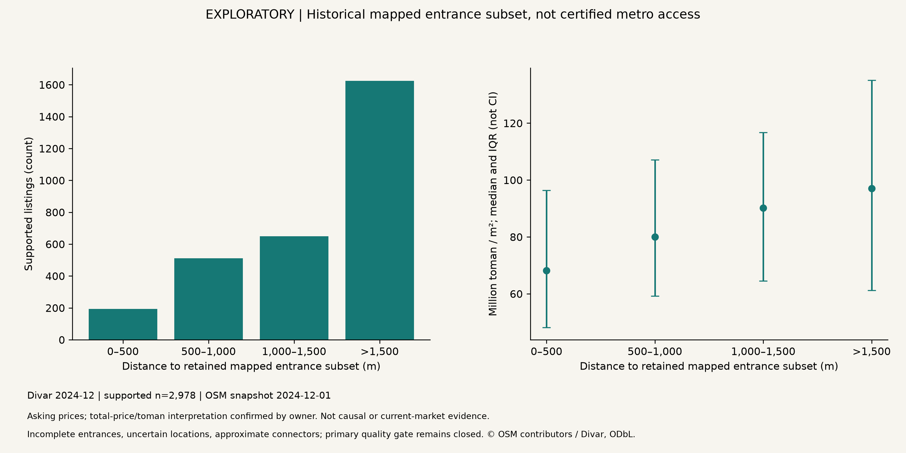

# Exploratory historical mapped-entrance results

Computed 23 October 2026 in run `20261023T055844-0795d47b`, using the predeclared [mapped-reference extension](mapped-reference-plan.md). This extends the housing-only release. It does not establish a metro price premium or nearest operational metro access. The primary `findings_available` and public metro-layer gates remain false.

## Inputs and provenance

The official Divar revision and owner-confirmed total-price/toman contract are unchanged. December 2024 contains 11,767 price-valid apartment-sale records. The OSM queries request the database at `2024-12-01T00:00:00Z`. The metro extract and one walking tile were downloaded by script; the owner supplied Line 5 and three walking tiles through browser exports of prepared queries. Their sidecars explicitly label request provenance as operator-attested, with no independent proof of the request that produced a saved file. All responses and checksums are retained privately.

The four-tile union contains 734,532 OSM objects. Conservative import produces 555,686 nodes, 1,236,780 directed edges and 1,532 weak components. Of 194 mapped entrance nodes, explicit stop-area membership and guide-name checks retain 166 entrances associated with 106 stop-area relations; all pass the baseline 100 m snapping rule. Stop-area counts are not independently verified unique operating-station counts. Operational dates, entrance completeness and representative physical routes remain unverified.

The successful run preserves config, source/input/output hashes, exact package versions and 30 scientific code/config snapshots. Its dirty Git state is recorded honestly. The earlier failed execution `20261023T055412-07a8b0a7` is preserved: strict JSON export rejected an undefined influence diagnostic before public export. Cook distances at unit leverage are now explicitly missing and counted; coefficient gates are unchanged. Boundary-sensitive routes retain no nominal distance band. Threshold-price comparisons require at least 30 measured observations on both sides.

## Coverage and distances

| Population or outcome | Count |
|---|---:|
| Price-valid December records | 11,767 |
| Coordinate-valid, known-radius routing candidates | 3,110 |
| Supported baseline routes | 2,978 |
| Origin snap exceeds 100 m | 87 |
| Boundary-sensitive routes | 31 |
| Disconnected/unreachable routes | 14 |
| Unknown or excessive radius | 6,741 |
| Missing or invalid coordinates | 1,916 |

Supported routes cover 95.76% of routing candidates, but only 25.31% of price-valid records. This selection must not be interpreted as population coverage. The median modeled route is 1,619.26 m; IQR 1,030.64-2,569.44 m. The median network-to-Euclidean distance ratio is 1.4269. Destinations are the retained mapped subset; missing entrances may inflate distance.

## Observed distributions and exploratory models

| Distance to retained mapped subset | n | Median asking price, million toman/m2 |
|---|---:|---:|
| Up to 500 m | 193 | 68.24 |
| 500-1,000 m | 512 | 80.00 |
| 1,000-1,500 m | 649 | 90.23 |
| Above 1,500 m | 1,624 | 97.07 |

These unadjusted distributions have different property and neighborhood composition. They do not establish a premium or discount caused by metro proximity.

The models share 2,962 complete observations across 281 neighborhoods. The exposure is an additional kilometer of modeled distance to the retained mapped entrance subset; outcome is log asking price per m2. Percent associations are `100 * (exp(beta) - 1)`. Confidence intervals use neighborhood-clustered CR1 covariance with t inference.

| Model | Association per additional km | Clustered 95% interval |
|---|---:|---|
| M1: unadjusted | -2.32% | -4.58% to -0.00051% |
| M2: property characteristics | -3.53% | -5.45% to -1.56% |
| M3: property characteristics and neighborhood | -9.87% | -22.85% to +5.28% |

The M3 interval spans zero. Its maximum Cook distance excludes and explicitly counts 45 undefined/unit-leverage observations, associated with singleton fixed-effect groups. Missing influence diagnostics are not zero influence. No model removes all spatial confounding or repairs the geography and selection limitations.

## Sensitivity and location uncertainty

Thirty uniform-area disk draws per candidate produce 93,300 location scenarios, of which 88,318 have supported routes: 5.34% fail. Among successful draws for nominally supported origins, 22.57% change distance band; 54.03% of nominally supported origins change band at least once. Uniform-area draws are an assumed scenario, not the measured error distribution; radius zero is not independently exact.

Ten whole-sample location perturbations refit the models. M3 point associations range from -7.38% to +3.02% per km, including sign changes. This range is a scenario sensitivity result, not a confidence interval or multiple-imputation inference. Tail omission changes the baseline M3 point association to -5.68%; Euclidean distance changes it to -3.02%. The 50/150 m snapping variants yield -5.52%/-10.36%. In the radius-at-most-100 m subset, M3 fails the rank/sample adequacy gate and remains unestimated.

The 2 km fixed-design spatial-cell wild bootstrap executes 199 draws over 144 occupied cells. Its M3 coefficient percentile sensitivity range is -0.2219 to -0.0044 in log-price units per km. This is not a calibrated spatial confidence interval: adjacent cells may remain dependent and the design, origins and destinations are approximate. Its disagreement with the neighborhood-cluster interval is a reason to retain uncertainty, rather than select a preferred interval after observing results.

## Interpretation and remaining work

Follow-up: the [historical network validation audit](historical-network-validation.md) now screens actual track geometry, documents the Line 5 exclusion and Line 3 endpoint gap, and adds scoped official inauguration evidence for three retained stop areas. It does not replace this model run or approve individual entrance operation.

The executable exploratory extension now supplies real mapped-subset routes, observational models and uncertainty diagnostics. It does not support a robust, operational metro-price-premium claim. Independent opening/operation evidence, topology and entrance completeness, representative route checks, selection analysis, expanded-area and additional-period sensitivities remain necessary for the primary research question. No public station/track geometry, listing coordinates, housing-price map, access ranking or causal conclusion is enabled.

Machine-readable evidence: [analysis](../artifacts/reports/mapped-analysis.json), [location scenarios and model refits](../artifacts/reports/mapped-location-sensitivity.json), [reproduction manifests](../artifacts/reports/reproduction-manifests.json).

